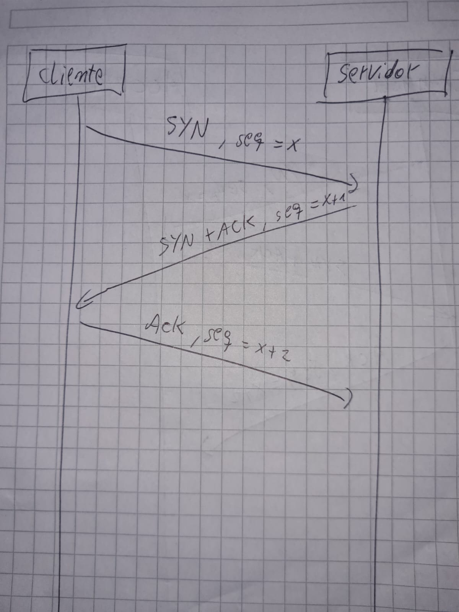
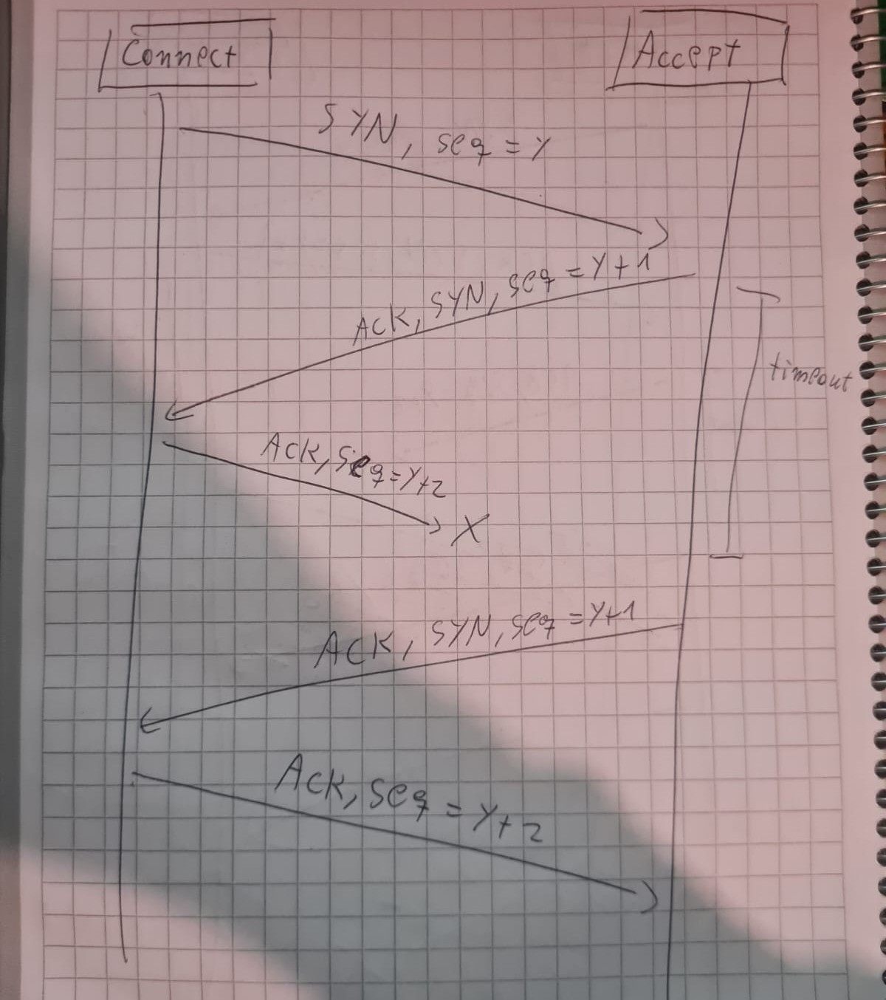

# Tarea 3 | Control 1
## Integrantes: Juxin Xu y Lucas Poblete

Se implementa la clase ``SocketTCP`` con la siguiente interfaz:

- `bind`
- `connect`
- `accept`
- `send`
- `recv`
- `close`
- `recv_close`

Con esta clase se pueden enviar mensajes orientados a conexion siguiendo el protoclo de la capa de transporte TCP.

---
## Diagramas
### Parte 4: Handhsake sin contemplar perdidas.
Se describen los envíos de segmentos de Connect por parte del cliente y Accept por parte del servidor durante el Handshake.

### Parte 7: Handhsake contempla perdidas.
Se estudia el caso en que el terser segmento no llegue.


---
## Test
para testear esta solución, estando situado en el repositorio `redes/Tarea3` debes ejecutar el servidor, quien crea un `SocketTCP`, recibe un mensaje y lo imprime en pantalla.
```
python3 servidor.py localhost 8000
```
Luego debes ejecutar el cliente, a quien le pasamos `archivo.txt`, crea un `SocketTCP` y envia el contenido del archivo al servidor.
```
python3 cliente.py localhost 8000 < archivo.txt
```
Para inducir perdidas se utiliza `netem`, se recomienda activar la opcion `--debug` para ver como reacciona el socket ante las perdidas.

Tambien se puede inducir perdidas a mano con la opcion `--perdida p` donde `p` un numero entre `0.0` y `1.0` que indica la cantidad de perdida.

En el siguiente ejemplo, se inicializa el servidor y el cliente respectivamente con 50% de perdida.
```
python3 servidor.py localhost 8000 --debug --perdida 0.5
```
```
python3 cliente.py localhost 8000 --debug --perdida 0.5 < archivo.txt
```
### Otros Tests

Se realizan los test de la seccion material complementario, para ello debera ejecutar `test_cliente.py` y `test_servdor.py` de la siguiente forma:
```
python3 test_servidor.py localhost 8000
```
```
python3 test_cliente.py localhost 8000
```
Y ademas se puede inducir perdidas con `netem` o a mano con `--perdida p`, ademas de poder activar la opcion `--debug` siempre que se necesite (recomendado con perdidas).
```
python3 test_servidor.py localhost 8000 --debug --perdida 0.5
```
```
python3 test_cliente.py localhost 8000 --debug --perdida 0.5
```
---
## Que hace el codigo

El envio de mensajes tanto para el handshake, mensajes y cierre, se hace a travez de segmentos, cada segmento es un diccionario de la siguiente forma:
```
{
    "ACK": Bool,
    "SYN": Bool,
    "FIN": Bool,
    "seq": bytes, #entero entre 0 y 9999 donde cada digito se representa como un byte
    "message": bytes #cadena de texto transformada a bytes en formato ASCII
}
```
Luego, antes de enviar el mensaje, se codifica a bytes, donde cada booleano es un byte y el `seq` se representa con 4 bytes (1 por digito), y el mensaje tiene un maximo de 16 bytes, luego se concatenan todos los bytes.

Al recibir cada segmento como una cadena de bytes, se separan los primeros 7 bytes de header, y los siguientes del mensaje para armar nuevamente el segmento.

Cuando se dice que se envía un ACK, SYN o FIN, significa que se envia un segmento con estos elementos en True, solamente envía contenido en el segmento el cliente cuando envia mensajes, en cualquier otra ocasión solo se envian los headers con el apartado `"message": b''`. `seq` funciona como indice, empieza como un numero random entre 1 y 1000, luego en cada segmento sin contenido se aumenta en 1, y si tiene contenido se aumenta con el largo de su contenido.

- Se implementa el handshake con `connect()` como el lado del cliente y `accept` como el lado del servidor. Siguiendo los tres pasos de este.
- Se implementa el envio de mensajes TCP con `send` del lado del cliente y `recv` del lado del servidor, primero se envía el largo del mensaje y se envia el primer segmento, se parte el mensaje en trozos de tamaño 16 bytes y se envia un trozo por segmento. el cliente envia un `ACK` y aumenta `seq` en el largo del mensaje del segmento, si el cliente recibe eso, puede enviar el siguiente segmento, si no, envia el mismo. Si el servidor recibe el mismo `seq` anterior, envia nuevamente el `ACK`.
- se immplementa el cierre de conexión con `close` del lado del cliente y `recv_close` del lado del servidor. el cliente intenta enviar `FIN` hasta 3 veces o hasta recibir `FIN+ACK`, si se logra recibir, intenta encia un `ACK` tres veces para asegurar su llegada y confirmar el cierre. Luego se cierra la conexion. Por el lado del servidor, recibe el mensaje, si no es de cierre, envia un `ACK` para confirmar que el mensaje ya habia sido resivido, luego, cuando reciba `FIN`, intenta hasta 3 veces enviar un `ACK+FIN`, luego, si llega el `ACK` final, cierra la conexion. si luego de los tres intentos, no se logra lo anterior, igualmente se cierra la conexion.